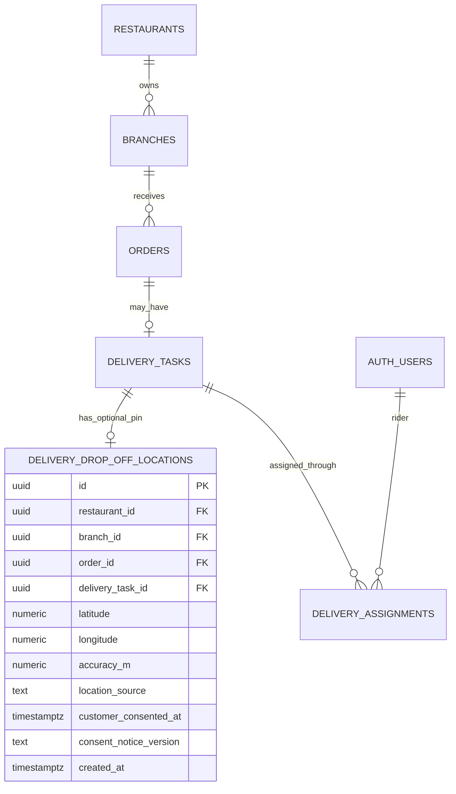

# Flame Chick Production — Drop-Off Pin ERD & Authorization Addendum V1

**Status:** Normative extension to the ERD and RLS/function matrix for the future static customer drop-off pin  
**Date:** 2026-11-20  
**Branch:** `work/production-source-audit`  
**Companions:** `customer-dropoff-pin-data-contract-v1.md`, `production-erd-v1.md`, `production-rls-grant-function-matrix-v1.md`  
**Production boundary:** Design only. No SQL, table, grant, policy, RPC, Edge Function, Realtime or app code has been created or enabled.

## 1. Exact scope

The only supported location feature is one optional, fixed delivery destination coordinate supplied by the customer. The assigned Rider and authorized POS staff can view it and open a Google Maps directions URL generated from the coordinate.

Explicitly excluded:
- Rider GPS / Rider live location;
- continuous customer GPS or updates;
- movement history, routes, geofencing or location polling;
- Realtime location broadcasting;
- browser/background tracking;
- arbitrary customer-provided map URLs.

A written delivery address remains required. The pin is optional and its absence never blocks checkout.

## 2. ERD extension

The `delivery_dropoff_locations` table is in `app_private`, not `public`.

### Candidate columns and constraints

- `id uuid primary key default gen_random_uuid()`
- `restaurant_id uuid not null`
- `branch_id uuid not null`
- `order_id uuid not null unique`
- `delivery_task_id uuid not null unique`
- `latitude numeric(9,6) not null CHECK (latitude BETWEEN -90 AND 90)`
- `longitude numeric(9,6) not null CHECK (longitude BETWEEN -180 AND 180)`
- `accuracy_m numeric(9,2) null CHECK (accuracy_m IS NULL OR accuracy_m >= 0)`
- `location_source text not null CHECK (location_source IN ('device_once','manual_map_pin'))`
- `customer_consented_at timestamptz not null`
- `consent_notice_version text not null`
- `created_at timestamptz not null default transaction_timestamp()`

Required relational constraints:
- Composite FK `(order_id, restaurant_id, branch_id)` references the same order.
- Composite FK `(delivery_task_id, restaurant_id, branch_id, order_id)` references the task bound to that same order and branch (or equivalent unique parent keys).
- No cascade delete from order/task/branch to this row. Terminal cleanup is an explicit retention operation; normal order operations must not erase location or audit evidence accidentally.
- One row per delivery order and one row per delivery task.
- Reject any pin for non-delivery fulfillment.
- A missing row means no pin was shared; never substitute (0,0).

If a table needs an FK to the task and order but their current unique keys do not support the required composite relationship, add the exact parent unique constraints first. Do not weaken tenant checks to make the FK convenient.

## 3. Transaction integration

### Customer website order

The existing public Order API remains the only public write entry. When an optional coordinate is included:
1. Validate the shape, numeric ranges, source and explicit customer consent context.
2. Resolve and validate tenant/branch and delivery fulfillment on the server.
3. Create the order, lines, order history, delivery task, optional drop-off pin and outbox event in the same database transaction.
4. If any write fails, all writes roll back. The successful-order website quota event is inserted in the same transaction as already specified.
5. Public success response never includes the coordinate or any order row containing private data.

No separate public RPC or direct browser table write is granted for location.

### POS and Rider reads

Use the existing Delivery API as the narrow read boundary, after adding a role-checked delivery-detail action. Do not create a new Edge Function for this feature.

- Verify JWT with Supabase Auth and derive `auth.uid()` on the server.
- Resolve current active Flame Chick role from database records; never trust a client role or user metadata.
- Recheck tenant, branch, task state and current assignment on each read.
- Rider access requires the caller to be the current active assignee of that exact delivery task.
- POS Admin/Owner may read across the restaurant; Manager/Cashier only within their active branch role and only as an operational delivery detail.
- Reassignment ends the old Rider's access immediately because authorization derives from the current assignment, not an old access grant.
- Rider cannot retrieve location for another Rider's offers or tasks by changing a UUID.
- No public or non-staff read.

## 4. Read/grant/RLS matrix extension

| Principal | Read precise pin | Write/change pin | Notes |
|---|---|---|---|
| Public guest / anon | No | No direct table write; only optional validated pin in the existing order-create command | No response contains coordinate |
| Authenticated non-staff | No | No | |
| Admin | Restaurant-wide operational delivery detail | Via authorized audited command only | Full business authority, distinct audit identity |
| Owner | Restaurant-wide operational delivery detail | Via authorized audited command only | Full business authority, distinct audit identity |
| Manager | Own branch operational delivery detail | No general pin edit | POS only; no Admin access |
| Cashier | Own branch operational delivery detail | No general pin edit | POS only |
| Assigned Rider | Own current active assignment only | No | No other Rider's pin |
| Former/unassigned Rider | No | No | Reassignment revokes prior Rider access |
| service_role | Server code only | Only inside scoped validated commands | Technical privilege; validate human actor when relevant |

Database exposure rules:
- Do not expose `app_private` through Supabase Data API.
- Revoke schema/table privileges from `PUBLIC`, `anon` and `authenticated`; grant no direct table SELECT/INSERT/UPDATE/DELETE to browser roles.
- Do not add the coordinate to a broadly accessible view or Realtime publication.
- Any security-definer helper must be in a non-exposed schema, have an empty/fixed safe search_path, controlled owner, schema-qualified objects, and exact EXECUTE grants. Prefer a narrowly scoped server-side read path; do not use SECURITY DEFINER as a shortcut.
- The service-only Delivery API query returns only coordinates for the exact authorized task. It must not return other delivery rows, customer contacts or staff-private fields unless required by that existing delivery DTO.
- Do not log the coordinate, generated map URL, full address or tokens.

## 5. Google Maps link handling

Generate the destination URL from validated coordinates using a fixed template:
`https://www.google.com/maps/dir/?api=1&destination=<latitude>,<longitude>`

- Never store or open a customer-provided URL.
- The Rider/POS app constructs the URL from the authorized coordinate.
- Validate and safely encode the pair. Use a normal safe external-link behavior (new tab/window with opener isolation where applicable).
- The maps link is not a credential and must not be included in logs, analytics or public responses.
- If Google Maps is unavailable, the rider can use the numeric coordinate and written delivery address as fallback.

## 6. Retention and lifecycle

- The pin is available to the assigned Rider only while the assignment is current and the task is non-terminal.
- POS branch users can view it only while the task is operational; Admin/Owner can view it under authorized business operations.
- Delivered, returned, cancelled or otherwise terminal delivery closes Rider access immediately.
- Proposed privacy retention: remove the precise coordinate within 24 hours after terminal status. Keep non-coordinate order/delivery and consent audit history under their separate retention rules.
- Purge with a bounded cleanup process and record cleanup completion without recording the coordinate. Confirm the 24-hour window before implementation.
- No background tracking, periodic update or location Realtime is necessary.

## 7. Required security and integrity tests

1. A customer can submit a valid optional pin with a delivery order; order/task/pin commit together.
2. A failed order transaction leaves no orphan pin and consumes no successful-order quota slot.
3. Pickup/dine-in order cannot attach a delivery pin.
4. Cross-tenant, cross-branch, wrong-order or wrong-task relationship is rejected by composite FKs/command checks.
5. Invalid latitude/longitude or accuracy is rejected.
6. Customer with no pin still completes checkout using the required written address.
7. An anonymous caller cannot read private pin storage through Data API, REST, RPC discovery or a guessed identifier.
8. A caller cannot use the pin submission path to read/change an order, task, payment or delivery status.
9. Rider A cannot read Rider B's pin, including when changing IDs in requests.
10. Rider who is reassigned immediately loses access; new assigned Rider gains only the new task's pin.
11. Manager/Cashier cannot read another branch's pin; Admin/Owner follow restaurant-wide authorization.
12. Disabled role or ended task/assignment blocks read even with an old client session.
13. Arbitrary/untrusted Maps URL is never stored/opened; only URL generated from validated coordinates is used.
14. Coordinate and map URL are absent from logs, analytics, broad notifications and public success response.
15. No Rider GPS, continuous customer location, update stream, location history or Realtime channel exists.
16. Cleanup removes only eligible coordinate rows and does not cascade-delete orders, tasks, payment history or audit events.

## 8. Normative precedence

For this feature, this addendum and `customer-dropoff-pin-data-contract-v1.md` supersede the old draft `customer-live-location-data-contract-v1.md`. The old draft is historical only and must never be used to build customer or Rider live tracking.

This is a design contract only. The customer website security audit remains a mandatory stop-gate immediately before website/database integration. Production remains read-only until separately approved.
